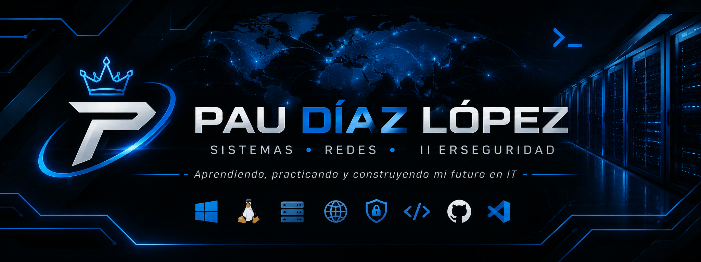

  

<h3 align="center">Tecnologías y herramientas</h3>

  

---

# Hola, soy Pau Díaz López

Estudiante de **SMR**, interesado en la administración de sistemas, redes y ciberseguridad.

### Especialidades

Windows Server · Linux · Active Directory · DNS · DHCP · Redes

### Proyectos

- Portfolio personal
- Laboratorios de administración de sistemas
- Prácticas de redes e infraestructura

### Contacto

  <a href="https://github.com/Paudiazlopez">
    
    GitHub
  </a>

---

  <i>Aprendiendo, practicando y construyendo mi futuro en IT.</i>

